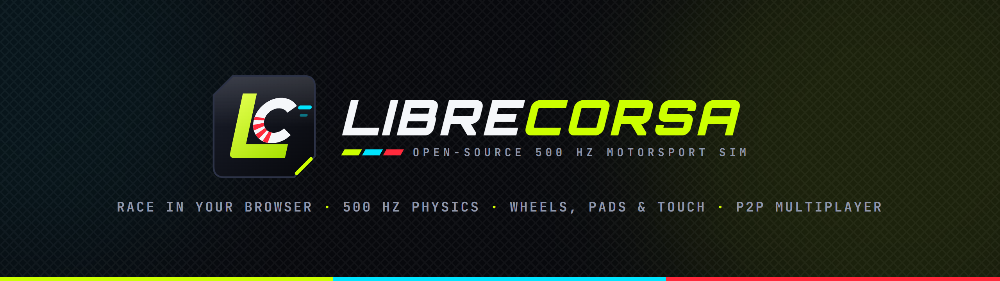
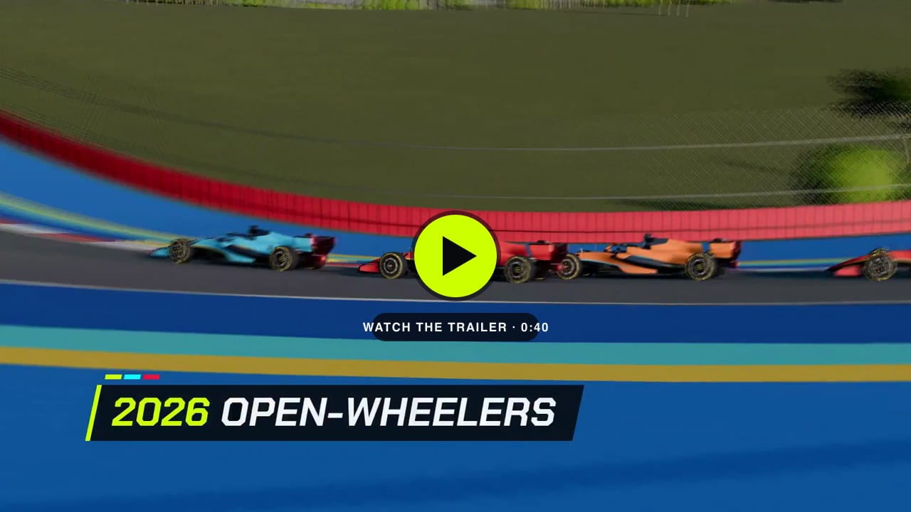
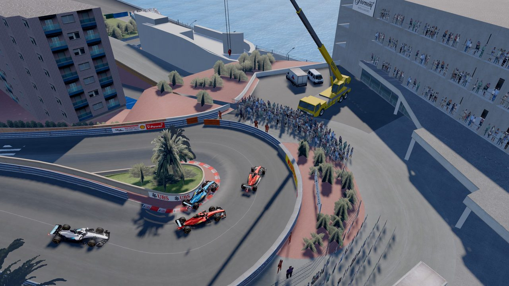
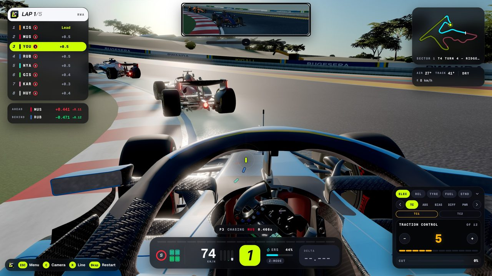
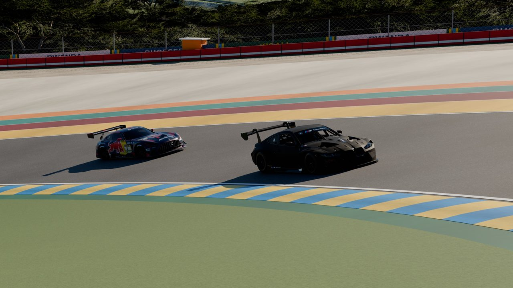
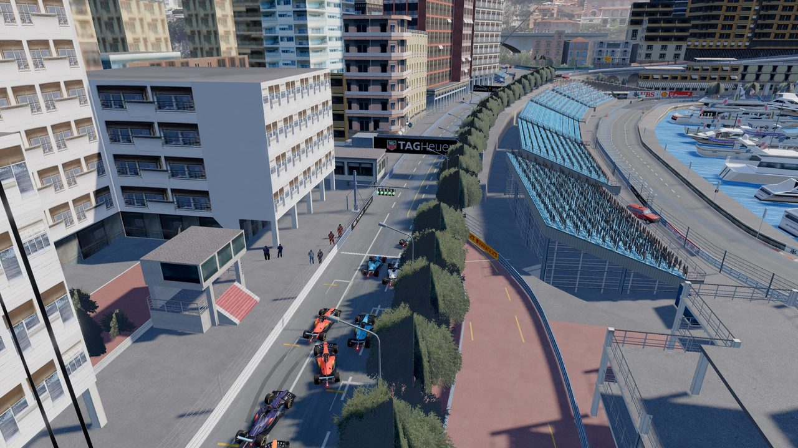
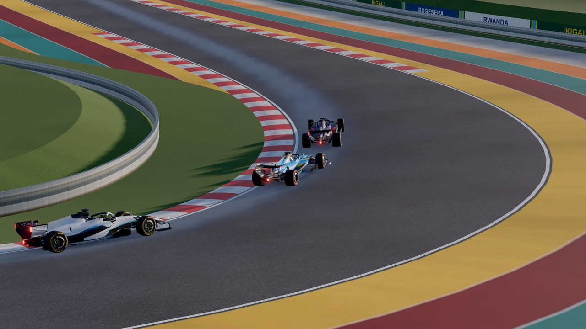
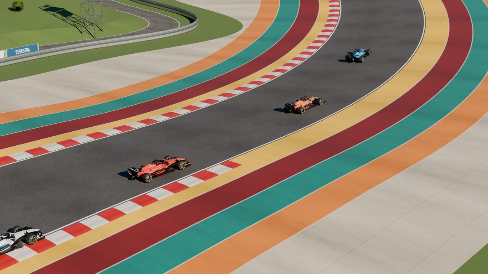

<h3>Free, open-source sim racing that runs in your browser</h3>

  <a href="https://librecorsa.org/"><b>▶&nbsp; Play now</b></a>
  &nbsp;·&nbsp;
  <a href="https://librecorsa.org/download"><b>Download</b></a>
  &nbsp;·&nbsp;
  <a href="https://docs.librecorsa.org/">Docs</a>
  &nbsp;·&nbsp;
  <a href="https://github.com/librecorsa/librecorsa">Source code</a>
  &nbsp;·&nbsp;
  <a href="https://github.com/librecorsa/librecorsa/discussions">Discussions</a>

  
  
  
  

**LibreCorsa** is a free and open-source racing simulator. Open [librecorsa.org](https://librecorsa.org/) and you're on track in seconds: nothing to install, no account, no store. Underneath it runs 500 Hz vehicle dynamics with a thermal tyre model, and it plays with a keyboard, a gamepad, a touch screen or a force-feedback wheel. I build it on my own and in the open, and all of the game's code is in [librecorsa/librecorsa](https://github.com/librecorsa/librecorsa).

<table>
  <tr>
    <td align="center" valign="top" width="25%"><h1>13</h1><b>cars</b> a 2026 open-wheeler, GT3s, prototypes and classics</td>
    <td align="center" valign="top" width="25%"><h1>20</h1><b>circuits</b> 35 layouts, plus two hill climbs</td>
    <td align="center" valign="top" width="25%"><h1>500 Hz</h1><b>physics</b> tyres that heat up, wear and aquaplane</td>
    <td align="center" valign="top" width="25%"><h1>12</h1><b>languages</b> Arabic reads right to left</td>
  </tr>
</table>

<table>
  <tr>
    <td width="33%"></td>
    <td width="33%"></td>
    <td width="33%"></td>
  </tr>
  <tr>
    <td align="center">Monaco, the hairpin</td>
    <td align="center">Onboard, with the race HUD</td>
    <td align="center">GT3s in the RISE bowl</td>
  </tr>
  <tr>
    <td width="33%"></td>
    <td width="33%"></td>
    <td width="33%"></td>
  </tr>
  <tr>
    <td align="center">Monaco, along the harbour</td>
    <td align="center">Side by side with the AI</td>
    <td align="center">RISE Motordrome, the esses</td>
  </tr>
</table>

## What you can do

<table>
  <tr>
    <td width="50%" valign="top">
      <b>Feel the car.</b> Every car is a 6-DOF rigid body on real suspension geometry. The tyres heat, wear and lose grip by temperature, pressure and load, the aero cares about ride height and dirty air, and the steering torque comes from the front tyres themselves. I check the GT3 against real car telemetry, and the build fails if it drifts.
    </td>
    <td width="50%" valign="top">
      <b>Race the AI.</b> Up to 11 opponents from Rookie to Alien, a standing start behind the lights, side-by-side racing, a podium and a results screen. The AI learns its braking points corner by corner, and in the rain it fits wets and drives to the grip.
    </td>
  </tr>
  <tr>
    <td valign="top">
      <b>Race people.</b> An open race on the week's circuit starts every 20 minutes. Private rooms take a 6-character code, and every circuit and car has its own online lap board, with a weekly challenge on top.
    </td>
    <td valign="top">
      <b>Drive in the weather.</b> Rain that builds and drains, a racing line that dries first, intermediates and full wets, aquaplaning, seven times of day and volumetric clouds.
    </td>
  </tr>
  <tr>
    <td valign="top">
      <b>Use what you have.</b> Force-feedback wheels straight from the browser over WebHID or through a Windows bridge, DualSense adaptive triggers and haptics, Xbox and PlayStation pads, touch pedals and tilt steering, and telemetry out over UDP for dashboards and rigs.
    </td>
    <td valign="top">
      <b>Watch it back.</b> Up to 20 minutes of instant replay with free and trackside TV cameras, a ghost of your best lap, and any lap on the boards to race as a ghost.
    </td>
  </tr>
</table>

## Cars and circuits

<table>
  <tr>
    <td width="50%" valign="top">
      <b>Cars</b>  
      <b>Open-wheeler</b> · 2026 Prototype 
      <b>GT3</b> · Mercedes-AMG GT3 Evo, BMW M4 GT3 Evo 
      <b>Prototypes</b> · LC-LMDH, MTRacing 496R 
      <b>Classics</b> · Nissan Skyline GT-R R33 JGTC and R32 JTCC, Porsche 934 Turbo RSR, BMW M1 Procar, Chaparral 2D and 2D 427 
      <b>Road cars</b> · Suzuki Liana 1.6, Volkswagen Scirocco GTX 16V
    </td>
    <td width="50%" valign="top">
      <b>Circuits</b>  
      RISE Motordrome · Circuit de Monaco · Red Bull Ring · Istanbul Park · Circuit de la Sarthe 1982 · Watkins Glen · Virginia International Raceway · Okayama · Chang · Qiddiya Speed Park · Sachsenring · Norisring · Oschersleben · Grobnik · Barbagallo · Riverside · Bridgehampton · Willow Springs · SpeedVegas · Dunsfold Aerodrome  
      <b>Hill climbs</b> · Goodwood · Borgloh
    </td>
  </tr>
</table>

## Play it anywhere

| Where | How |
| :-- | :-- |
| **Any modern browser**, on a computer, phone or tablet | [librecorsa.org](https://librecorsa.org/) |
| **Windows**, **macOS** and **Linux** | Desktop app from [librecorsa.org/download](https://librecorsa.org/download) or [GitHub Releases](https://github.com/librecorsa/librecorsa/releases/latest) |
| **Android** | Full-screen app from [librecorsa.org/download](https://librecorsa.org/download) |

The apps open the live game, so updates reach you without reinstalling anything.

## Repositories

| Repository | What's in it |
| :-- | :-- |
| [**librecorsa**](https://github.com/librecorsa/librecorsa) | The game, its physics and AI, the online side (rooms, lap boards and open races on Cloudflare), the desktop and Android apps, and the docs site |
| [**.github**](https://github.com/librecorsa/.github) | This page |

## Get involved

- **Found a bug?** [Open an issue](https://github.com/librecorsa/librecorsa/issues/new/choose). Drove it with a wheel? A [wheel report](https://github.com/librecorsa/librecorsa/issues/new?template=wheel-report.yml) tells me what works.
- **Have an idea or a lap time to brag about?** Post it in [Discussions](https://github.com/librecorsa/librecorsa/discussions).
- **Make cars or circuits?** The [porting guides](https://docs.librecorsa.org/) walk through bringing a car or a circuit into the game.
- **Speak another language?** [TRANSLATING.md](https://github.com/librecorsa/librecorsa/blob/main/docs/TRANSLATING.md) shows how to fix or add a translation.
- **Found a security problem?** Please [report it privately](https://github.com/librecorsa/librecorsa/security/advisories/new).

## Made with the help of modders

Much of what you drive and see comes from modders and 3D artists who gave me permission or share their work under open licences: **Mitja Bonca**, **dazzyb2k3**, **gunnar333**, **LilSki**, **Gogol**, **Nukedrop**, **Enver Bozkaya**, **Maxim555**, **Zhenix**, **ACU**, **munyuturbo**, **gregsediting**, **Pfalzdriver**, **NPanic**, **alekabul**, **sagatron918**, **Qvist Designs**, **Vecarz**, **Ddiaz Design**, **kilianhoffmann13**, **DeX** and **Purple Sector**. Thank you. Who made what, and under which licence, is in [CREDITS.md](https://github.com/librecorsa/librecorsa/blob/main/CREDITS.md).

## Support and licence

LibreCorsa is free. If you'd like to help with hosting, you can [buy me a coffee](https://buymeacoffee.com/alpyalayg); it never unlocks anything.

The code is under the [GNU AGPL 3.0](https://github.com/librecorsa/librecorsa/blob/main/LICENSE). The 3D models and audio are for non-commercial use, and each keeps its own licence.

 

Made by Alp Yalay · <a href="https://www.youtube.com/@KhazAlp">YouTube</a> · <a href="https://x.com/alpyalay">X</a>
 
LibreCorsa is an independent fan project. It isn't affiliated with Formula 1, the FIA, any team or any circuit.

